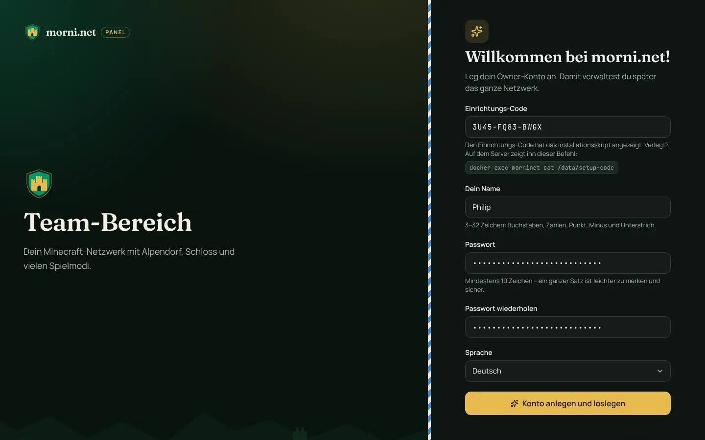
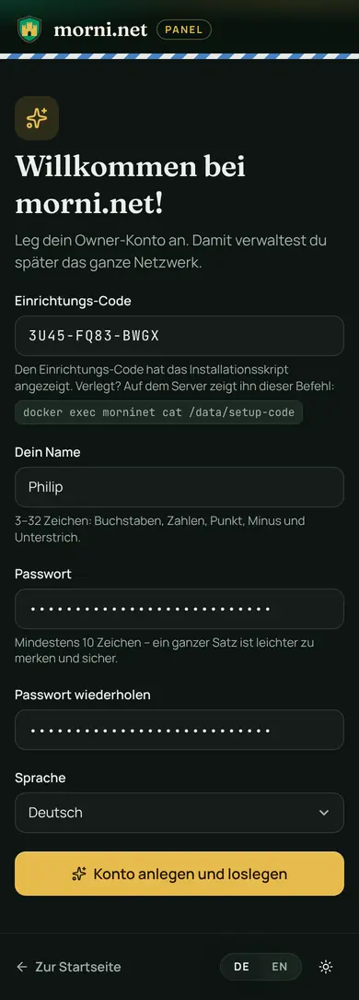
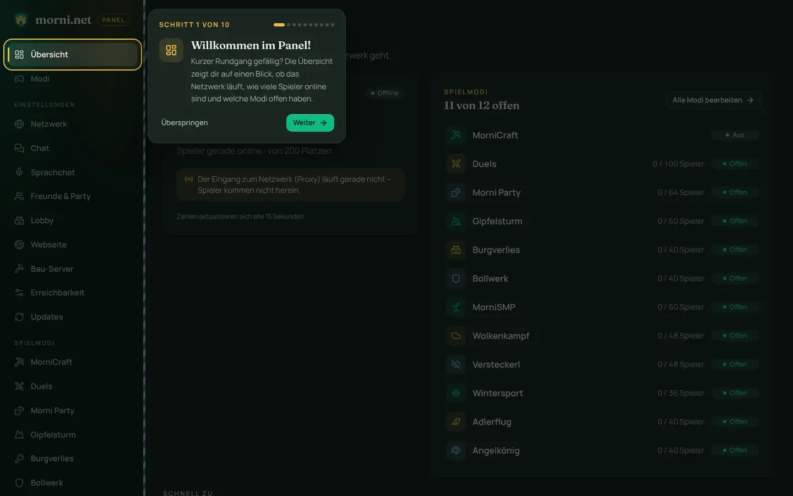
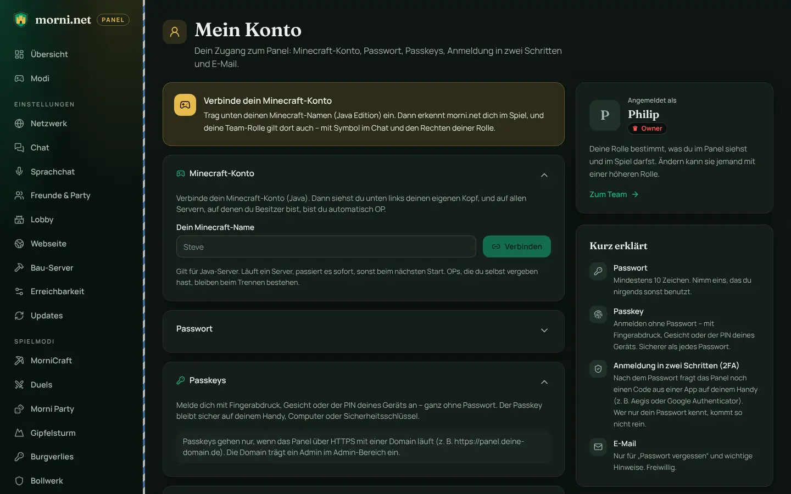
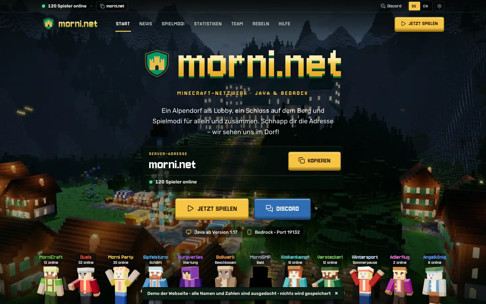
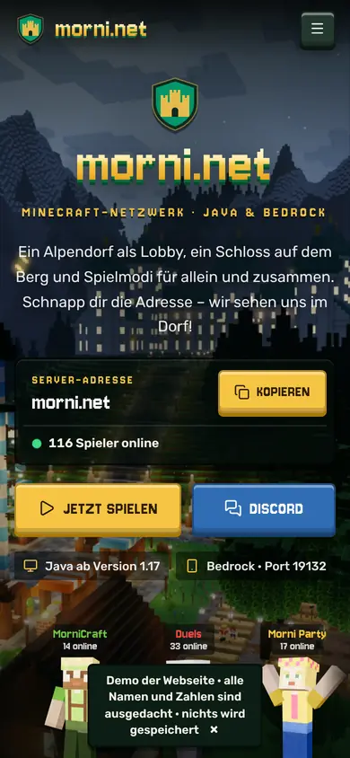
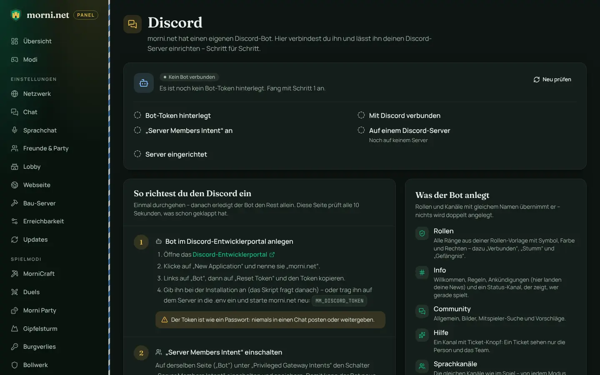
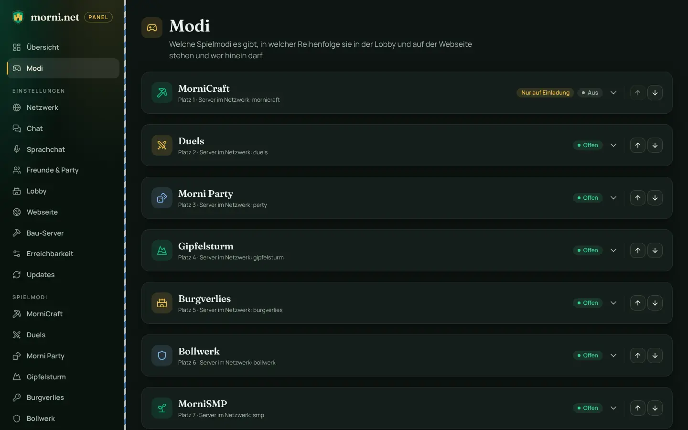

# Von null zu MoinMorni

Diese Anleitung bringt dich vom leeren Rechner bis zum fertigen Minecraft-Netzwerk: Proxmox installieren, MoinMorni mit
einem Befehl aufsetzen, Owner-Konto anlegen, unter deiner Domain erreichbar machen, Discord-Bot verbinden. Du brauchst
kein Vorwissen – jeder Schritt sagt dir, **woran du merkst, dass es geklappt hat**.

Plane etwa zwei Stunden ein. Das meiste davon ist Warten (Installation, Updates, DNS).

| Teil                                                                            | Was du machst                                        | Dauer         |
| ------------------------------------------------------------------------------- | ---------------------------------------------------- | ------------- |
| [1. Was du brauchst](#1-was-du-brauchst)                                        | Rechner, Domain, Konten bereitlegen                  | –             |
| [2. Proxmox installieren](#2-proxmox-installieren)                              | USB-Stick, Installation, Weboberfläche, Updates      | 30–45 Min.    |
| [3. Der Container](#3-der-container)                                            | ein Befehl in der Proxmox-Shell                      | 15–30 Min.    |
| [4. Erste Einrichtung](#4-erste-einrichtung)                                    | Owner-Konto im Browser anlegen                       | 5 Min.        |
| [5. Erreichbar machen](#5-erreichbar-machen)                                    | Domain bei INWX, NetBird, „Hausanschluss verstecken“ | 20 Min. + DNS |
| [6. Discord-Bot](#6-discord-bot)                                                | Bot anlegen, einladen, Server einrichten lassen      | 10 Min.       |
| [7. Spielmodi](#7-spielmodi)                                                    | nichts – sie kommen von selbst                       | –             |
| [8. Modpack, Updates, Sicherungen](#8-modpack-updates-sicherungen-dauerbetrieb) | einmal ansehen, einmal einstellen                    | 10 Min.       |
| [9. Einmal auf GitHub](#9-einmal-auf-github-nur-philip)                         | `main` anlegen                                       | 5 Min.        |
| [10. Probleme und Lösungen](#10-probleme-und-lösungen)                          | wenn etwas hakt                                      | –             |

So hängt am Ende alles zusammen:

```text
 Spieler und Besucher tippen „moinmorni.net“
            │  DNS bei INWX
            ▼
 IONOS-Server (feste IP im Internet) ── NetBird-Proxy: Webseite mit HTTPS, Minecraft-Ports
            │  verschlüsselter NetBird-Tunnel – zu Hause bleibt der Router zu
            ▼
 Proxmox bei dir zu Hause
   └─ Container „moinmorni“: Webseite + Panel, Motor (MorniHosting), Minecraft-Server (Proxy, Lobby, Spielmodi)
```

---

## 1. Was du brauchst

### Einen Rechner für zu Hause

Ein Mini-PC oder ein alter Desktop-Rechner reicht, solange er genug Arbeitsspeicher hat. Er läuft Tag und Nacht, ein
sparsames Gerät lohnt sich.

|                 | Mindestens                                 | Empfohlen                        |
| --------------- | ------------------------------------------ | -------------------------------- |
| Prozessor       | 4 Kerne, Intel oder AMD (64 Bit, „x86-64“) | 8 Kerne oder mehr mit hohem Takt |
| Arbeitsspeicher | 16 GB                                      | 48–64 GB                         |
| Festplatte      | SSD mit 128 GB                             | NVMe-SSD mit 500 GB oder mehr    |
| Netzwerk        | Netzwerkkabel zum Router                   | Netzwerkkabel zum Router         |

- **Kein Raspberry Pi:** Proxmox VE läuft nur auf Intel- und AMD-Prozessoren.
- **Kabel statt WLAN:** Proxmox kommt mit WLAN schlecht zurecht.
- **Die Festplatte wird komplett gelöscht.** Nimm einen Rechner, auf dem nichts Wichtiges mehr liegt.

**Wie viel Arbeitsspeicher wofür?** Der Container für MoinMorni bekommt als Standard **32 GB RAM, 8 Kerne und 100 GB
Festplatte**. **Alle Server sind immer online**, Spieler kommen sofort hinein: Proxy 1 GB, Lobby 3 GB, Bau-Server
1,5 GB, MorniSMP und MorniCraft je 3 GB, Morni Party 2 GB, die übrigen Spielmodi je 1,5 GB – zusammen 27 GB, das passt
in 32 GB. Das sind Höchstwerte: Ist in einem Modus niemand, hält Minecraft dort die Welt an und Java gibt den
Arbeitsspeicher zurück – ein leerer 1,5-GB-Modus braucht dann etwa 0,7 GB statt 1,4 GB. Im Panel unter Modi lässt sich
je Modus auch „Schlafen, wenn leer“ einschalten: dann geht er ganz aus und wacht in etwa einer halben Minute auf.

| RAM für MoinMorni | Was gleichzeitig läuft                                                          |
| ----------------- | ------------------------------------------------------------------------------- |
| 8 GB              | Lobby, Proxy und zwei kleine Spielmodi – die übrigen schlafen, bis jemand kommt |
| 14–16 GB          | Lobby und etwa 6 Spielmodi gleichzeitig                                         |
| 32 GB (Standard)  | alle Server gleichzeitig, immer online                                          |
| 48 GB und mehr    | alles gleichzeitig, mit Luft                                                    |

Reicht der Speicher nicht für alle, schickt MoinMorni vor dem Start eines Modus erst leere Modi schlafen; sie wachen
auf, sobald jemand hinein will. Weniger RAM heißt also nicht „geht nicht“, sondern „nicht alles auf einmal“. Hat dein
Rechner weniger als 34 GB, nimmt das Installationsskript von selbst weniger und sagt dir, was das bedeutet.

### Und außerdem

- **Internet zu Hause:** Wichtiger als Tempo ist eine stabile Leitung. Faustregel: pro Spieler, der gleichzeitig
  spielt, etwa 0,5 Mbit/s im Upload.
- **Die Domain `moinmorni.net`** bei INWX (dort trägst du später die DNS-Einträge ein).
- **NetBird** mit Reverse Proxy auf einem Server mit fester IP im Internet – bei dir der IONOS-Server, auf dem dein
  NetBird läuft. Darüber erreichen alle MoinMorni, ohne dass du zu Hause Ports freigibst und ohne dass jemand die IP
  deines Hausanschlusses sieht. (Ohne NetBird geht es nur mit Portfreigaben im Router – das beschreibt diese Anleitung
  nicht.)
- **Ein Discord-Konto** für den Bot (Teil 6).
- **Einen USB-Stick** mit mindestens 4 GB (wird gelöscht) und einen zweiten Rechner mit Browser.

---

## 2. Proxmox installieren

[Proxmox VE](https://www.proxmox.com/de/) ist ein kostenloses Betriebssystem für Server. Es verwaltet „Container“:
abgeschlossene kleine Linux-Systeme, in denen jeweils ein Dienst läuft. MoinMorni bekommt seinen eigenen Container.

Nimm für alles in diesem Teil nur die offiziellen Seiten von Proxmox und der genannten Programme.

### 2.1 Proxmox herunterladen

1. Öffne <https://www.proxmox.com/de/downloads> und lade bei **Proxmox Virtual Environment** den neuesten
   **ISO-Installer** (Version 9) herunter. Die Datei ist etwa 1,5 GB groß und heißt z. B. `proxmox-ve_9.x-y.iso`.
2. Optional, aber gut: Prüf, ob die Datei heil angekommen ist. Neben dem Download steht eine lange **SHA256**-Prüfsumme.
   Unter Windows zeigt dir dieser Befehl (in PowerShell, im Download-Ordner) die Prüfsumme deiner Datei:

   ```powershell
   Get-FileHash .\proxmox-ve_*.iso -Algorithm SHA256
   ```

   Unter macOS und Linux:

   ```bash
   shasum -a 256 proxmox-ve_*.iso
   ```

**Geklappt, wenn** beide Prüfsummen genau gleich sind.

### 2.2 USB-Stick bootfähig machen

Am einfachsten mit **balenaEtcher** (Windows, macOS, Linux): <https://etcher.balena.io>

1. Etcher starten → **Flash from file** → die ISO-Datei wählen.
2. **Select target** → deinen USB-Stick wählen (genau hinschauen – er wird gelöscht).
3. **Flash!** und warten, bis „Flash Complete“ dasteht.

Andere Wege: Unter Windows geht auch **Rufus** (<https://rufus.ie>) – wenn Rufus fragt, **„Im DD-Abbild-Modus
schreiben“** wählen. **Ventoy** (<https://www.ventoy.net>) geht oft auch (ISO einfach auf den Stick kopieren); startet
der Proxmox-Installer damit nicht, nimm Etcher.

### 2.3 Rechner vorbereiten (BIOS/UEFI)

1. Rechner einschalten und gleich mehrmals die Taste fürs Setup drücken – meist **Entf**, **F2** oder **F10** (steht
   oft kurz unten auf dem Bildschirm).
2. Schalte die **Virtualisierung** ein. Sie heißt je nach Hersteller **Intel Virtualization Technology (VT-x)** oder
   **SVM Mode** (AMD) und steckt meist unter „Advanced“ oder „CPU Configuration“. Für Container wäre sie nicht einmal
   nötig, aber Proxmox meckert sonst, und für virtuelle Maschinen brauchst du sie später.
3. **Secure Boot** darfst du anlassen – Proxmox VE kann das.
4. Speichern und neu starten (meist **F10**).

### 2.4 Proxmox installieren

1. USB-Stick einstecken, Rechner starten und das **Boot-Menü** öffnen (meist **F12**, **F11**, **F8** oder **Esc**).
   Wähl den USB-Stick (bei zwei Einträgen den mit „UEFI“).
2. Im Menü des Installers: **Install Proxmox VE (Graphical)**.
3. Lizenz: **I agree**.
4. **Target Harddisk:** die Festplatte für Proxmox wählen. Unter **Options** kannst du das Dateisystem lassen, wie es
   ist (`ext4`). Hast du zwei gleiche Festplatten, nimm **ZFS (RAID1)** – dann ist alles doppelt gespeichert.
   **Alles auf der gewählten Platte wird gelöscht.**
5. **Location and Time Zone:** Country `Germany`, Time zone `Europe/Berlin`, Keyboard Layout `German`.
6. **Administration Password and Email:** ein starkes Passwort für den Benutzer `root` (aufschreiben!) und deine
   E-Mail-Adresse (Proxmox schickt dorthin Warnungen, z. B. wenn eine Sicherung scheitert).
7. **Management Network Configuration** – hier bekommt Proxmox seine feste Adresse im Heimnetz:

   | Feld                 | Beispiel (FRITZ!Box) | Erklärung                                                                   |
   | -------------------- | -------------------- | --------------------------------------------------------------------------- |
   | Management Interface | `enp1s0`             | der Netzwerkanschluss mit dem Kabel                                         |
   | Hostname (FQDN)      | `pve.home.arpa`      | Name des Rechners; `home.arpa` ist die offizielle Endung fürs Heimnetz      |
   | IP Address (CIDR)    | `192.168.178.10/24`  | eine Adresse, die dein Router nicht selbst verteilt (FRITZ!Box: .2 bis .19) |
   | Gateway              | `192.168.178.1`      | dein Router                                                                 |
   | DNS Server           | `192.168.178.1`      | auch dein Router                                                            |

   Der Installer schlägt Werte aus deinem Netz vor. Wichtig ist nur, dass die IP-Adresse fest ist und kein anderes Gerät
   sie bekommt.

8. **Summary:** Haken bei **Automatically reboot after successful installation** lassen → **Install**. Nach ein paar
   Minuten startet der Rechner neu – dann den USB-Stick abziehen.

**Geklappt, wenn** auf dem Bildschirm des Rechners steht: „Welcome to the Proxmox Virtual Environment. Please use your
web browser to configure this server – connect to: `https://192.168.178.10:8006/`“. Bildschirm und Tastatur brauchst du
ab jetzt nicht mehr.

### 2.5 Die Weboberfläche öffnen

1. Öffne auf deinem anderen Rechner im Browser die Adresse von eben, z. B. `https://192.168.178.10:8006`.
2. Der Browser warnt vor dem Zertifikat. Das ist hier normal (der Rechner hat sich sein Zertifikat selbst ausgestellt):
   Chrome **Erweitert → Weiter zu …**, Firefox **Erweitert… → Risiko akzeptieren und fortfahren**.
3. Anmelden: Benutzername `root`, Realm **Linux PAM standard authentication**, dein Passwort aus Schritt 2.4. Unten
   kannst du die Sprache auf **Deutsch** stellen.
4. Es kommt der Hinweis **„Keine gültige Subskription“**. Einfach **OK** – Proxmox ist kostenlos, die Subskription ist
   nur bezahlter Support.

**Geklappt, wenn** links unter **Rechenzentrum** dein Rechner (z. B. `pve`) steht und rechts unter **Übersicht**
CPU-Auslastung und Arbeitsspeicher zu sehen sind.

### 2.6 Proxmox auf den neuesten Stand bringen

Ohne Subskription holst du Updates aus dem kostenlosen „No-Subscription“-Paketarchiv.

1. Links deinen Rechner (`pve`) wählen → **Updates → Repositorys** (englisch _Repositories_).
2. Den Eintrag mit **enterprise** im Namen anklicken → **Deaktivieren**. Gibt es einen zweiten (für „ceph“ mit
   enterprise), den auch.
3. **Hinzufügen** → bei Repository **No-Subscription** wählen → **Hinzufügen**.
4. Links auf **Updates** → **Aktualisieren** (lädt die Liste), dann **Upgrade**. Es öffnet sich ein Fenster mit der
   Konsole; bestätige mit `Y` und Enter.
5. Wurde ein neuer Kernel installiert, rechts oben **Neustart**.

Das geht auch in der **Shell** (links `pve` → **Shell**) mit zwei Befehlen nacheinander:

```bash
apt update
```

```bash
apt full-upgrade
```

**Geklappt, wenn** unter **Updates** nach **Aktualisieren** keine Pakete mehr in der Liste stehen.

> Es gibt bekannte Skripte von Freiwilligen, die diese Schritte automatisch erledigen (z. B. „Proxmox VE Post Install“
> von community-scripts.org). Die brauchst du nicht – wenn du sie trotzdem nutzt, dann auf eigene Gefahr.

---

## 3. Der Container

Jetzt kommt MoinMorni auf deinen Proxmox – mit **einem** Befehl.

> Der Befehl klappt erst, wenn der Code auf GitHub im Branch `main` liegt (siehe [Teil 9](#9-einmal-auf-github-nur-philip)).

**Vorher bereitlegen (beides optional, geht auch später):**

- den **Token deines Discord-Bots** – wie du ihn bekommst, steht in [Teil 6](#6-discord-bot), Schritte 1 bis 3,
- einen **NetBird-Setup-Key**: im NetBird-Dashboard **Setup Keys → Create Setup Key**.

### 3.1 Den Befehl ausführen

1. In der Proxmox-Weboberfläche links deinen Rechner (`pve`) wählen → **Shell**.
2. Diese Zeile kopieren und in die Shell einfügen (Rechtsklick → **Einfügen** oder **Strg+Umschalt+V**), dann Enter:

```bash
bash -c "$(curl -fsSL https://raw.githubusercontent.com/pmornhart/moinmorni.net/main/proxmox/moinmorni.sh)"
```

Das Skript schaut sich zuerst deinen Rechner an:

```text
 ✔ Proxmox VE 9.0.11
 ✔ Dein Proxmox: 16 Kerne, 63 GB RAM (58 GB gerade frei)
```

Dann stellt es dir ein paar Fragen in blauen Fenstern. Die Maus geht dort meist nicht, alles geht mit der Tastatur:
Mit **Tab** springst du zwischen Feld und Knöpfen, in Listen wählst du mit den **Pfeiltasten**, mit **Enter** bestätigst
du, mit **Esc** brichst du ab (dann wird nichts angelegt). Das steht auch oben auf jedem Fenster.

### 3.2 Die Fragen

1. **Container-ID** – die Nummer, unter der der Container in Proxmox steht. Jede Nummer gibt es nur einmal. Nimm einfach
   den Vorschlag (auf einem frischen Proxmox ist das `100`). Mit dieser Nummer sprichst du den Container später an, in
   dieser Anleitung heißt sie `<ID>`.
2. **Domain** – `moinmorni.net`. Dort stehen später Webseite und Panel, und die Spieler verbinden sich mit dieser Adresse.
   Ohne `https://` und ohne `/`.
3. **Discord-Bot** – den Token einfügen. Die Eingabe bleibt unsichtbar. Der Token landet nur in der
   Einstellungs-Datei im Container, die nur `root` lesen darf – nie in der Ausgabe, in der Prozessliste oder in einem
   Protokoll. **Leer lassen geht auch**, dann trägst du ihn später ein (Teil 6).
4. **NetBird gleich mit einrichten?** – mit Setup-Key **Ja**, sonst **Nein** (geht später auch).
   - **Setup-Key** einfügen (bleibt ebenfalls unsichtbar).
   - **Wo läuft dein NetBird?** – Betreibst du NetBird selbst (wie auf deinem IONOS-Server), gib hier seine Adresse ein,
     so wie du das NetBird-Dashboard öffnest, z. B. `https://netbird.example.de`. Nutzt du NetBird Cloud (netbird.io),
     lass das Feld leer.
5. **So wird der Container angelegt** – alle Werte auf einen Blick, dazu Hinweise, falls an deinem Rechner etwas knapp
   ist (RAM, Kerne, freier Platz). Die Festplatte nimmt höchstens 60 % vom freien Platz auf dem Speicher mit dem
   meisten Platz (mindestens 40 GB, höchstens 100 GB) – vergrößern geht später jederzeit. Zwei Knöpfe:
   - **Anlegen** – nimmt die Standard-Einstellungen. Das ist für fast alle richtig.
   - **Erweitert** (mit **Tab** hinüber, dann **Enter**) – du legst selbst fest: Name des Containers, CPU-Kerne, RAM,
     Swap, Proxmox-Speicher, Festplatte, Netzwerk-Bridge, **feste IP-Adresse** (statt vom Router) samt Gateway und
     Debian-Version. Danach siehst du die Übersicht nochmal.

Vertippt? Das Skript sagt, was nicht passt, und fragt nochmal.

> **Tipp – feste IP:** Unter **Erweitert** kannst du bei „IP-Adresse“ statt `dhcp` z. B. `192.168.178.50/24` eintragen
> (eine Adresse, die dein Router nicht selbst verteilt). Dann ist das Panel zu Hause immer unter derselben Adresse.

### 3.3 Was jetzt passiert

Das Skript lädt eine Debian-Vorlage, legt den Container an (sicher, ohne Sonderrechte auf dem Proxmox-Rechner), startet
ihn, installiert Docker aus der offiziellen Quelle von Docker, lädt MoinMorni von GitHub und baut es. **Beim ersten Mal
dauert das 10 bis 30 Minuten**, je nach Rechner und Internet. Du musst nichts tun.

Was genau passiert und alle Einstellungen zum Nachlesen: [Proxmox-Einzeiler im Detail](proxmox-quickstart.md).

### 3.4 Das Ende

Zum Schluss steht da (mit deinen Werten):

```text
 🎉 MoinMorni ist bereit!

    Container 100 „moinmorni“ · IP 192.168.178.50

    1. Leg dein Owner-Konto an – im Browser bei dir zu Hause:
       http://192.168.178.50:8080/panel/einrichtung
       Einrichtungs-Code: ABCD-EFGH-JKLM
       (Sobald deine Domain steht, geht es auch über https://moinmorni.net/panel/einrichtung)
    2. NetBird: im Panel unter Einstellungen → Erreichbarkeit verbinden …
    3. Discord-Bot: Schritt für Schritt im Panel unter „Discord“.

    Code nochmal anzeigen: pct exec 100 -- docker exec moinmorni cat /data/setup-code
    In den Container:      pct enter 100
```

Schreib dir die **IP** und den **Einrichtungs-Code** auf (oder lass das Fenster offen).

**Geklappt, wenn** links in Proxmox ein Container `100 (moinmorni)` mit grünem Pfeil steht und
`http://<IP>:8080` im Browser die Webseite von MoinMorni zeigt.

Ging etwas schief, sagt das Skript, in welcher Zeile. Der Container bleibt dann zum Nachsehen stehen. Hilfe gibt es in
[Teil 10](#10-probleme-und-lösungen).

---

## 4. Erste Einrichtung

Noch zeigt deine Domain nicht auf den Container – das kommt in Teil 5. Bis dahin richtest du alles von zu Hause aus ein.

1. Öffne auf einem Rechner in deinem Heimnetz `http://<IP>:8080/panel` (die IP vom Ende des Skripts, mit `http`, nicht
   `https`). Du landest von selbst auf der Einrichtung.
2. Trag den **Einrichtungs-Code** ein, dazu deinen **Namen** (3–32 Zeichen: Buchstaben, Zahlen, Punkt, Minus,
   Unterstrich), ein **Passwort** (mindestens 10 Zeichen – ein ganzer Satz ist leichter zu merken und sicher) und die
   **Sprache**.
3. **Konto anlegen und loslegen.**

<p>
  
  
</p>

Dein Konto ist jetzt **Owner** – du darfst alles. Den Code brauchst du danach nicht mehr, und niemand kann sich selbst
registrieren: Team-Konten legst du im Panel unter **Team** an.

**Geklappt, wenn** das Panel dich mit einem kurzen Rundgang begrüßt. Er erklärt dir in zehn Schritten, wo was ist.



### 4.1 Gleich danach: dein Konto absichern

Öffne im Menü des Panels **Mein Konto**:

- **Anmeldung in zwei Schritten (2FA):** Nach dem Passwort fragt das Panel zusätzlich einen Code aus einer App auf
  deinem Handy (z. B. Aegis, 2FAS oder Google Authenticator). Richte das jetzt ein.
- **Minecraft-Konto:** Trag deinen Minecraft-Namen (Java) ein. Dann erkennt MoinMorni dich im Spiel, und dein Rang
  (♛ Owner) gilt dort auch.
- **Passkeys** (Anmelden mit Fingerabdruck oder Gesicht) gehen nur über HTTPS auf deiner Domain – die richtest du nach
  Teil 5 ein, wenn `https://moinmorni.net/panel` läuft.



### 4.2 Das Netzwerk baut sich selbst

Sobald es das Owner-Konto gibt, legt MoinMorni von selbst an: den **Proxy** (der Eingang für alle Spieler, mit Java ab
1.17 und Bedrock), die **Lobby** (das Alpendorf mit den Figuren) und den **Bau-Server** fürs Bauteam. Die Lobby baut
sich danach Block für Block auf. Das dauert ein paar Minuten.

**Geklappt, wenn** unter **Übersicht** das Netzwerk läuft und unter **Server** Proxy, Lobby und Bau-Server stehen. Zu
Hause kannst du jetzt schon spielen:

- **Java:** Mehrspieler → Direktverbindung → `<IP>` (die IP des Containers).
- **Bedrock:** Server → Server hinzufügen → Adresse `<IP>`, Port `19132`.

Bist du drin, begrüßt dich das Dorf mit „Servus in MoinMorni!“.

---

## 5. Erreichbar machen

Jetzt bekommt MoinMorni seine Adresse im Internet. Danach gilt für alle:

| Wer               | Adresse                                           |
| ----------------- | ------------------------------------------------- |
| Webseite          | `https://moinmorni.net`                           |
| Panel fürs Team   | `https://moinmorni.net/panel`                     |
| Minecraft Java    | `moinmorni.net` (ohne Port, jede Version ab 1.17) |
| Minecraft Bedrock | `moinmorni.net`, Port `19132`                     |

Und das Schönste: Zu Hause gibst du **keine Ports** frei, und **niemand sieht die IP deines Hausanschlusses**. Alle
kommen beim IONOS-Server an, NetBird reicht sie durch einen verschlüsselten Tunnel zu dir weiter. Auch was MoinMorni
selbst im Internet aufruft (Mojang, Modrinth, GitHub, Discord), geht über den IONOS-Server hinaus.

Alle Einzelheiten zu NetBird – mit Erklärungen, was NetBird erlaubt und was nicht – stehen in der
**[NetBird-Anleitung](netbird.md)**. Hier die Schritte in der richtigen Reihenfolge:

### 5.1 NetBird im Container

Hast du beim Skript einen Setup-Key angegeben, ist das schon erledigt: Im NetBird-Dashboard unter **Peers** steht ein
Rechner `moinmorni`. Sonst holst du es jetzt nach. Wechsle in der Proxmox-Shell in den Container:

```bash
pct enter <ID>
```

NetBird installieren (erst laden, dann ausführen):

```bash
curl -fsSL https://pkgs.netbird.io/install.sh -o /tmp/netbird.sh
```

```bash
sh /tmp/netbird.sh
```

Den Setup-Key unsichtbar eingeben (einfügen, Enter – er landet so nicht in der Befehls-Chronik):

```bash
read -rs NB_SETUP_KEY && export NB_SETUP_KEY
```

Verbinden – bei deinem eigenen NetBird-Server mit dessen Adresse (bei NetBird Cloud ohne `--management-url …`):

```bash
netbird up --management-url https://netbird.example.de
```

```bash
unset NB_SETUP_KEY; exit
```

**Geklappt, wenn** `netbird status` im Container `Management: Connected` zeigt und der Rechner `moinmorni` im
NetBird-Dashboard unter **Peers** grün ist.

### 5.2 Domain bei NetBird und INWX

1. Im NetBird-Dashboard: **Reverse Proxy → Custom Domains → Add Domain** → `moinmorni.net` → speichern. MoinMorni braucht
   seine **eigene** Domain in NetBird – nicht die deines MorniHosting.
2. NetBird zeigt dir danach, welche DNS-Einträge nötig sind. Trag sie bei **INWX** ein (im Kundenbereich bei der Domain
   `moinmorni.net` die DNS- bzw. Nameserver-Einträge öffnen). Meist sind das:

   | Typ   | Name              | Wert                                    |
   | ----- | ----------------- | --------------------------------------- |
   | A     | `moinmorni.net`   | die öffentliche IP deines IONOS-Servers |
   | CNAME | `*.moinmorni.net` | die Adresse deines NetBird-Proxys       |

   Für `moinmorni.net` selbst geht nur ein **A-Eintrag**, kein CNAME. Nimm immer genau die Werte, die NetBird anzeigt.

3. In NetBird **Verify Domain** – das kann ein paar Minuten dauern, selten bis zu einem Tag.

**Geklappt, wenn** NetBird die Domain als bestätigt (**Active**) zeigt. Zusätzlich kannst du auf deinem Rechner prüfen,
wohin `moinmorni.net` zeigt – es muss die IP deines IONOS-Servers herauskommen:

```bash
nslookup moinmorni.net
```

### 5.3 Im Panel: Einstellungen → Erreichbarkeit

Das richtest nur du als **Owner** ein. Du brauchst einen Schlüssel für NetBird: im NetBird-Dashboard **Team → Service
Users → Create Service User** (Rolle „Admin“) → **Create Token**, den Schlüssel (`nbp_…`) kopieren. Er wird verschlüsselt
gespeichert und nie wieder angezeigt.

Dann im Panel unter **Einstellungen → Erreichbarkeit**:

1. **NetBird verbinden** – Schlüssel einfügen, Domain `moinmorni.net` und den Rechner `moinmorni` wählen.
2. **Webseite auf der Domain** – einrichten. Danach ist `https://moinmorni.net` die Webseite und `https://moinmorni.net/panel`
   dein Panel, mit HTTPS.
3. **Spiel auf der Domain** – den vorgeschlagenen Proxy übernehmen. Dann tippen Spieler nur noch `moinmorni.net`.
4. **Hausanschluss verstecken** – den NetBird-Server als Ausgang wählen. Danach prüft MoinMorni, mit welcher IP es ins
   Internet geht: grün heißt versteckt. Zeigt die Karte Namen, die noch auf deinen Hausanschluss zeigen, lösch diese
   Einträge bei INWX. Dafür muss auf dem IONOS-Server neben dem NetBird-Proxy auch der normale NetBird-Agent laufen –
   läuft das für MorniHosting schon, ist nichts zu tun.

Die genauen Knöpfe und was dahinter passiert: [NetBird-Anleitung](netbird.md).

> **Ports am IONOS-Server:** Ein selbst betriebener NetBird-Proxy lässt nur Ports durch, die auf dem IONOS-Server
> freigegeben sind – in Docker und in der Firewall im IONOS-Kundenmenü. MoinMorni braucht HTTPS (443), für Java und den
> Sprachchat **TCP und UDP 25565** und für Bedrock **TCP und UDP 19132**. Benutzt in deinem NetBird schon etwas 25565
> oder 19132 (z. B. der Adress-Verteiler von MorniHosting), bekommt MoinMorni die nächste freie Nummer – welche, zeigt
> die Karte unter **Erreichbarkeit**.

**Geklappt, wenn**

- `https://moinmorni.net` die Webseite zeigt (mit Schloss im Browser),
- du dich unter `https://moinmorni.net/panel` anmelden kannst,
- Minecraft Java mit der Adresse `moinmorni.net` in die Lobby kommt – auch vom Handy-Hotspot aus, also nicht über dein
  Heimnetz,
- die Karte „Hausanschluss verstecken“ grün ist.

<p>
  
  
</p>

So sieht die Webseite aus (Bild aus der Demo, die Zahlen sind ausgedacht). Jetzt kannst du unter **Mein Konto →
Passkeys** einen Passkey anlegen.

---

## 6. Discord-Bot

MoinMorni hat einen eigenen Discord-Bot. Er richtet deinen Discord-Server ein (Rollen, Kanäle, Befehle), zeigt, wer
gerade spielt, gleicht Ränge und Strafen ab und kümmert sich um Tickets und Bewerbungen. Im Panel unter **Discord**
führt dich eine Seite durch dieselben Schritte und hakt ab, was schon klappt.



### 6.1 Bot anlegen (einmal)

1. Öffne das Discord-Entwicklerportal: <https://discord.com/developers/applications> → **New Application** → Name
   `MoinMorni` → **Create**.
2. Links **Bot** → **Reset Token** → **Yes, do it!** → den Token kopieren. Er wird nur einmal angezeigt. **Der Token ist
   wie ein Passwort: nie in einen Chat, nie in einen Screenshot, nie ins Repo.**
3. Auf derselben Seite unter **Privileged Gateway Intents** den Schalter **Server Members Intent** einschalten und
   speichern. **Public Bot** ausschalten – dann kannst nur du ihn auf einen Server holen.

### 6.2 Token eintragen

Hast du den Token beim Skript in Teil 3 schon angegeben, überspring diesen Schritt.

Sonst trägst du ihn in die Einstellungs-Datei im Container ein. In der Proxmox-Shell:

```bash
pct enter <ID>
```

```bash
nano /opt/moinmorni/.env
```

Such die Zeile `MM_DISCORD_TOKEN=`, füg den Token direkt hinter dem `=` ein (ohne Leerzeichen), speichere mit
**Strg+O**, Enter und schließe mit **Strg+X**. Dann MoinMorni mit dem neuen Wert starten und den Container verlassen:

```bash
cd /opt/moinmorni && docker compose up -d
```

```bash
exit
```

### 6.3 Server anlegen und einrichten lassen

1. In Discord links auf **+** → **Eigenen erstellen** → **Für mich und meine Freunde** → Name, z. B. `MoinMorni`. Lass ihn
   leer: Discord erlaubt Bots nicht mehr, selbst Server anzulegen – den Rest macht der Bot.
2. Im Panel unter **Discord** auf **Bot einladen** → deinen neuen Server wählen → **Autorisieren**.
3. Im Panel **Server einrichten** klicken. Nach etwa einer halben Minute sind Rollen (♛ Owner, ⚔ Moderator, ★ VIP …),
   Kanäle (Info, Community, Hilfe mit Ticket-Knopf, Sprachkanäle wie im Spiel, Team) und Befehle (`/verbinden`,
   `/hilfe`, `/bewerben`, `/status`) da.

**Geklappt, wenn** das Panel unter **Discord** „Alles eingerichtet“ zeigt und der Bot in Discord online ist. Im Kanal
`status` steht, wer gerade spielt.

Mehr dazu (auch „Mit Discord anmelden“ für MorniCraft-Bewerbungen auf der Webseite): [Discord einrichten](discord.md).

---

## 7. Spielmodi

Hier musst du nichts tun. Jeder Spielmodus hat sein eigenes Repo auf GitHub. **Einmal pro Stunde schaut MoinMorni
nach**, welche davon eine fertige Version (ein „Release“) haben, legt für jeden einen eigenen Server an und spielt die
neueste Version auf. Neue Versionen kommen genauso von selbst.

- **Alle Modi sind immer online** – ohne Spieler hält Minecraft die Welt an und gibt Arbeitsspeicher zurück. Wer einen
  Modus lieber ganz schlafen lässt: Panel → Modi → „Schlafen, wenn leer“ (wacht in etwa einer halben Minute auf).
- **Panel → Modi:** an- und ausschalten, Wartung, Reihenfolge in der Lobby und auf der Webseite, wie viele Spieler
  hinein dürfen.
- **Einstellungen der Modi** stehen im Panel in der Gruppe **Spielmodi** – mit Suche und Erklärung. Sie gelten nach dem
  nächsten Neustart des Modus; MoinMorni startet ihn von selbst neu, sobald niemand darin spielt.
- **MorniCraft** ist ab Werk **aus** und nur für Leute auf der **Whitelist**. Bewerben können sich Spieler auf der
  Webseite unter `https://moinmorni.net/mornicraft/bewerben` oder im Discord mit `/bewerben`. Annehmen und ablehnen kannst
  du in Discord oder im Panel unter **Einstellungen → MorniCraft**. Einschalten unter **Modi**.



**Geklappt, wenn** ein Modus in der Lobby an seinem Stand eine Spielerzahl zeigt und du nach einem Klick auf die Figur
darin landest.

---

## 8. Modpack, Updates, Sicherungen, Dauerbetrieb

### Modpack (freiwillig)

Für Java gibt es ein eigenes Modpack mit schönerer Grafik, Zoom, flüssigerem Spiel und dem Sprachchat. Spieler
installieren es mit der Modrinth App oder dem Prism Launcher – wie das geht und wie du es veröffentlichst:
[Modpack](modpack.md). Ohne Modpack geht alles genauso, nur ohne Extras. Bedrock braucht keins.

### Updates

MoinMorni hält sich selbst aktuell: **einmal am Tag um 4 Uhr**, und nur, **wenn niemand spielt**. Vorher macht es eine
Sicherung; klappt etwas nicht, geht es von selbst zurück auf den alten Stand. Die Minecraft-Server laufen weiter. Im
Discord-Team-Log steht, was neu ist. Einstellen (Uhrzeit, an/aus) und von Hand starten: **Panel → Einstellungen →
Updates**. Auch aus der Proxmox-Shell:

```bash
pct exec <ID> -- moinmorni-update
```

Proxmox selbst aktualisierst du ab und zu wie in [Teil 2.6](#26-proxmox-auf-den-neuesten-stand-bringen) – etwa einmal
im Monat.

### Sicherungen

- **Vor jedem Update** sichert MoinMorni seine Datenbanken (Ränge, Strafen, Statistiken, Einstellungen) im Container
  unter `/var/backups/moinmorni` – die letzten fünf bleiben.
- **Welten** sicherst du im Panel unter **Server** → Server wählen → **Backups**, auch als Zeitplan.
- **Am einfachsten und vollständig:** Proxmox sichert den ganzen Container. Links **Rechenzentrum → Backup →
  Hinzufügen**: als **Speicher** am besten eine zweite Festplatte oder ein NAS (nie nur dieselbe Platte), als Zeitplan
  z. B. täglich um 3 Uhr, Auswahl dein Container, Modus **Snapshot**, Aufbewahrung z. B. die letzten 7. Zurückholen:
  Container → **Backup** → Sicherung wählen → **Wiederherstellen**.

### Dauerbetrieb

- Der Container **startet mit Proxmox**. Nach einem Stromausfall kommt alles von selbst wieder.
- MoinMorni und der Motor starten neu, wenn sie abstürzen. Spielserver, die abstürzen, startet der Motor wieder.
- Auf dem Proxmox-Host passt der **Host-Wächter** auf den Container auf: Ist er aus, ohne dass du ihn gestoppt hast,
  startet er ihn wieder; hängt er, startet er ihn neu (Status auf dem Host: `moinmorni-host-guard status`).
- Im Container prüft ein **Wächter** jede Minute NetBird, DNS, Docker und die Container von MoinMorni und repariert
  selbst. Was er tut, steht im Discord-Team-Log (Details in der [NetBird-Anleitung](netbird.md#wächter)). Status:

```bash
pct exec <ID> -- moinmorni-guard status
```

---

## 9. Einmal auf GitHub (nur Philip)

Ein paar Dinge gehen nur im GitHub-Konto `pmornhart`:

1. **Branch `main`:** Nach deinem Go wird der Entwicklungs-Branch nach `main` übernommen (Pull Request). Dann im
   Netzwerk-Repo **Settings → General → Default branch** → `main`. **Erst danach gibt es den Befehl aus Teil 3** – er
   lädt das Skript aus `main` (vorher meldet `curl` „404“).
2. **Die Modus-Repos** brauchen je eine fertige Version (ein Release). Die baut GitHub von selbst, sobald ein Modus nach
   deinem Go auf `main` landet. Alle Repos bleiben öffentlich – MoinMorni holt die Versionen ohne Anmeldung.

   | Modus       | Repo                          |
   | ----------- | ----------------------------- |
   | MorniCraft  | `pmornhart/MorniCraft`        |
   | Duels       | `pmornhart/MoinMorni-Duels`   |
   | Morni Party | `pmornhart/Morni-Party`       |
   | Gipfelsturm | `pmornhart/Morni-Gipfelsturm` |
   | Burgverlies | `pmornhart/Morni-Burgverlies` |
   | Bollwerk    | `pmornhart/Morni-Bollwek`     |
   | MorniSMP    | `pmornhart/Morni-SMP`         |
   | Wolkenkampf | `pmornhart/morni-wolkenkampf` |
   | Versteckerl | `pmornhart/Morni-Versteckerl` |
   | Wintersport | `pmornhart/morni-wintersport` |
   | Adlerflug   | `pmornhart/morni-adlerflug`   |
   | Angelkönig  | `pmornhart/morni-angelkoenig` |

**Geklappt, wenn** diese Adresse im Browser ein Skript zeigt (statt „404: Not Found“) und unter **Releases** der
Modus-Repos jeweils eine Version mit einer `.jar`-Datei steht:
<https://raw.githubusercontent.com/pmornhart/moinmorni.net/main/proxmox/moinmorni.sh>

---

## 10. Probleme und Lösungen

Alle Befehle gehören in die **Shell des Proxmox-Rechners** (links `pve` → **Shell**). `<ID>` ist die Nummer deines
Containers.

<details>
<summary><b>Der Befehl aus Teil 3 meldet „404“ oder „Not Found“</b></summary>

Das Skript liegt noch nicht im Branch `main` – siehe [Teil 9](#9-einmal-auf-github-nur-philip).

</details>

<details>
<summary><b>Das Skript bricht ab: „Proxmox VE 8 oder 9“, „keine Debian-Vorlage“, „kein Speicher“</b></summary>

- **Version:** Ältere Proxmox-Versionen bekommen keine Sicherheits-Updates mehr. Installier Proxmox VE 9 neu (Teil 2).
- **Debian-Vorlage:** Der Proxmox-Rechner kommt nicht ins Internet. Prüf das Kabel und die Einstellungen aus Teil 2.4
  (Gateway, DNS) und dann [Teil 2.6](#26-proxmox-auf-den-neuesten-stand-bringen).
- **Speicher:** Es gibt keinen Speicher für Container. Bei einer normalen Installation heißt er `local-lvm` (oder
  `local-zfs` bei ZFS).

</details>

<details>
<summary><b>Das Skript warnt: zu wenig RAM, Kerne oder Platz</b></summary>

Das sind nur Hinweise – MoinMorni läuft trotzdem. Mit weniger RAM laufen weniger Spielmodi gleichzeitig (die übrigen
schlafen, bis jemand kommt). Später mehr geben: siehe „Mehr RAM oder Kerne für den Container“ und „Speicher voll“
weiter unten. Ist auf dem Proxmox-Speicher zu wenig frei, nimm unter **Erweitert** eine kleinere Festplatte – sie
lässt sich später vergrößern.

</details>

<details>
<summary><b>Der Container startet nicht</b></summary>

Was Proxmox meint, zeigt dieser Befehl:

```bash
pct start <ID> --debug
```

Steht dort „CT is locked“, hängt noch eine alte Aufgabe – dann:

```bash
pct unlock <ID>
```

```bash
pct start <ID>
```

Ist der Proxmox-Speicher voll, siehe „Speicher voll“ weiter unten.

</details>

<details>
<summary><b>Das Panel ist nicht erreichbar</b></summary>

- Zu Hause mit **`http://`** (nicht `https://`) und **Port 8080** öffnen: `http://<IP>:8080/panel`.
- Direkt nach dem Skript baut MoinMorni beim ersten Start noch – ein paar Minuten warten.
- Welche IP hat der Container gerade?

  ```bash
  pct exec <ID> -- hostname -I
  ```

- Laufen alle drei Teile (`moinmorni`, `moinmorni-motor`, `moinmorni-socket-proxy`)?

  ```bash
  pct exec <ID> -- docker ps
  ```

- Wenn nicht, starten:

  ```bash
  pct exec <ID> -- bash -c "cd /opt/moinmorni && docker compose up -d"
  ```

- Was MoinMorni zuletzt gemeldet hat:

  ```bash
  pct exec <ID> -- docker logs --tail 50 moinmorni
  ```

Über `https://moinmorni.net/panel` geht es erst nach Teil 5.

</details>

<details>
<summary><b>Einrichtungs-Code verloren</b></summary>

```bash
pct exec <ID> -- docker exec moinmorni cat /data/setup-code
```

Gibt es die Datei nicht mehr, ist die Einrichtung schon fertig – dann meldest du dich einfach an.

</details>

<details>
<summary><b>Passwort vergessen oder Handy mit der 2FA-App verloren</b></summary>

Neues Passwort für dein Konto (der Name ist der aus der Einrichtung; es steht danach in der Shell):

```bash
pct exec <ID> -- docker exec moinmorni-motor node /app/server/dist/cli.js reset-password <Name>
```

Anmeldung in zwei Schritten ausschalten:

```bash
pct exec <ID> -- docker exec moinmorni-motor node /app/server/dist/cli.js reset-2fa <Name>
```

Alle Konten anzeigen:

```bash
pct exec <ID> -- docker exec moinmorni-motor node /app/server/dist/cli.js list-users
```

Danach unter **Mein Konto** ein eigenes Passwort setzen und 2FA neu einrichten.

</details>

<details>
<summary><b>Der Discord-Bot ist offline</b></summary>

Das Panel zeigt unter **Discord** oben, woran es liegt:

- **„Kein Bot verbunden“:** Der Token fehlt – [Teil 6.2](#62-token-eintragen).
- **„Token stimmt nicht“:** Im Entwicklerportal einen neuen erzeugen (**Reset Token**) und eintragen.
- **„Ein Schalter fehlt“:** **Server Members Intent** im Entwicklerportal einschalten.
- **„Online, ohne Server“:** Den Bot einladen (Panel → Discord → **Bot einladen**).

Was der Bot zuletzt gemeldet hat:

```bash
pct exec <ID> -- docker logs --tail 100 moinmorni
```

</details>

<details>
<summary><b>NetBird ist getrennt</b></summary>

```bash
pct exec <ID> -- netbird status
```

```bash
pct exec <ID> -- moinmorni-guard status
```

Der Wächter verbindet NetBird von selbst neu. Steht bei NetBird „NeedsLogin“, ist die Anmeldung abgelaufen – dann mit
einem neuen Setup-Key wie in [Teil 5.1](#51-netbird-im-container) verbinden. Mehr in der
[NetBird-Anleitung](netbird.md#wenn-etwas-nicht-klappt).

</details>

<details>
<summary><b>Bedrock kommt nicht rein</b></summary>

- Adresse `moinmorni.net`, Port `19132` – oder die Nummer, die das Panel unter **Einstellungen → Erreichbarkeit** nennt.
- Seit Bedrock 26.60 braucht es **TCP und UDP** auf dem Bedrock-Port. Am IONOS-Server müssen beide offen sein (Teil
  5.3).
- Zu Hause testen: Adresse = IP des Containers, Port `19132`. Klappt das, liegt es an NetBird oder dem IONOS-Server.

</details>

<details>
<summary><b>Java kommt von außen nicht rein, zu Hause schon</b></summary>

- Zeigt `nslookup moinmorni.net` die IP deines IONOS-Servers? Sonst stimmen die Einträge bei INWX nicht (Teil 5.2).
- Ist am IONOS-Server Port 25565 offen (Docker und Firewall im Kundenmenü)?
- Hat MoinMorni in NetBird eine andere Nummer bekommen (Panel → **Erreichbarkeit**)? Dann geht `moinmorni.net:<Nummer>`
  oder ein SRV-Eintrag bei INWX ([NetBird-Anleitung](netbird.md)).

</details>

<details>
<summary><b>Der Sprachchat verbindet sich nicht</b></summary>

Der Sprachchat läuft über **UDP** auf demselben Port wie Java (meist 25565). Ist dieser UDP-Port am IONOS-Server nicht
freigegeben, kommt man zwar ins Spiel, hört aber niemanden. Auf Java braucht es außerdem die Mod Simple Voice Chat (im
Modpack dabei); Bedrock hat keinen Sprachchat.

</details>

<details>
<summary><b>Speicher voll</b></summary>

Wie voll ist der Container?

```bash
pct exec <ID> -- df -h /
```

Wie voll sind die Proxmox-Speicher?

```bash
pvesm status
```

Container um 50 GB vergrößern (verkleinern geht nicht):

```bash
pct resize <ID> rootfs +50G
```

Aufräumen: alte Welt-Backups im Panel löschen und Docker-Reste entfernen:

```bash
pct exec <ID> -- docker image prune -f
```

</details>

<details>
<summary><b>Mehr RAM oder Kerne für den Container</b></summary>

RAM in MB (hier 48 GB), gilt sofort:

```bash
pct set <ID> --memory 49152
```

CPU-Kerne:

```bash
pct set <ID> --cores 12
```

</details>

<details>
<summary><b>Ein Update ist schiefgegangen</b></summary>

MoinMorni geht dann von selbst auf den alten Stand zurück und läuft weiter. Das Protokoll steht im Panel unter
**Einstellungen → Updates**. Nochmal von Hand versuchen:

```bash
pct exec <ID> -- moinmorni-update
```

</details>

<details>
<summary><b>Docker startet im Container nicht</b></summary>

Der Container braucht die Optionen **Nesting** und **keyctl** (Container → **Optionen → Features**; das Skript setzt
beide). Hilft das nicht, Proxmox aktualisieren ([Teil 2.6](#26-proxmox-auf-den-neuesten-stand-bringen)) und den
Container neu starten:

```bash
pct reboot <ID>
```

</details>

<details>
<summary><b>Ganz von vorn anfangen</b></summary>

Löscht den Container mit allem darin (Welten, Datenbanken, Einstellungen):

```bash
pct stop <ID>
```

```bash
pct destroy <ID>
```

Dann den Befehl aus Teil 3 nochmal ausführen.

</details>
